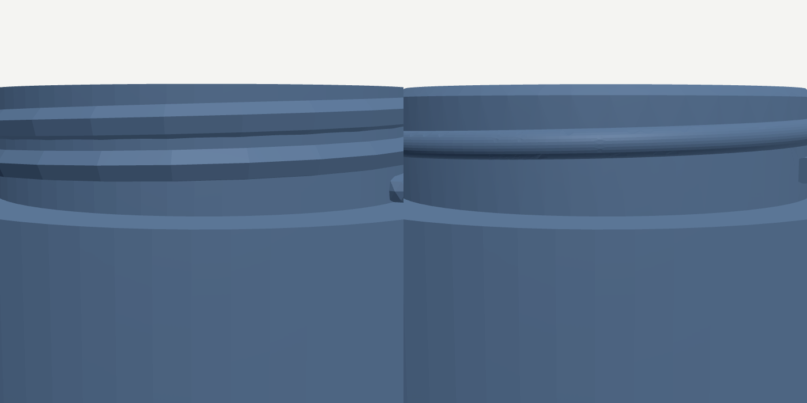
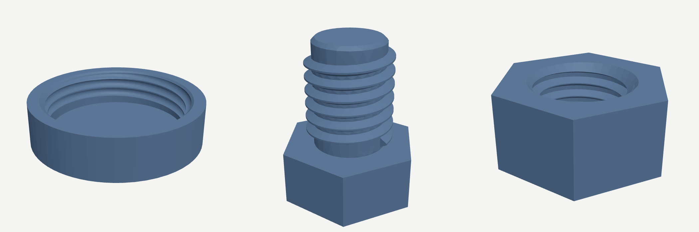

# Exact screw threads

`thread()` builds a screw thread as an exact B-rep solid, and `tube(helix())`
builds a coil as one. Before this, a thread was `tube({ r }, helix({ ... }))`:
a round bead swept along a point list and imported as triangles, which put the
whole model on the mesh lane (faceted in Design mode, no STEP curves, no fillet
after it). Code: `src/thread.js`; the engine side is `expandSweeps()` in
`src/engine.js`; tests: `test/thread.js`.





## What each kernel offers

| Kernel | Helix | Sweep along it | Thread primitive | Used for threads |
|---|---|---|---|---|
| next.BREP.io Rust (wasm, web + desktop) | `HX` feature: a cubic fit through 64 stations a turn (~2e-7 x radius), published with its screw axis | `SW` with `orientationMode: "pathAlign"` screws a sketch profile up the helix's own axis (true screw motion, volume matches Pappus exactly). The ABI also has `sweep_profile_helix()` (same core, profile transplanted square to the path, with coil-collision guards) and `sweep_profile_along_path()` | none; no ruled helicoid either | **yes** |
| NVIDIA SMLib (desktop alpha) | `SmApiCreateHelix` (B-spline fit to a stated tolerance) | `SmApiCreateCurveSweep` (also `SmApiCreatePipeSweep`, `SmApiCreateSweep` / `SmApiCreateRuledSurface` / `SmApiCreateSkin` for single surfaces) | none | not yet: see below |
| BREP.io JS (fallback) | `HX` | `SW` | none | reads the thread's triangles |

SMLib was built and measured on Linux (2026-10-26): the sweep takes about
0.1 s and its union with the core 0.1-0.2 s, about a hundred times faster than
the Rust kernel. But `SmApiCreateCurveSweep` rolls the profile along the helix
instead of screwing it (an M8 crest drifts from 4.00 to 4.42 mm over 12 turns,
volume 6.6% light at 3 turns), so it is not wired in. The adapter refuses `HX`
/ `SW`, the model goes on to the Rust kernel, and the TODO with the exact calls
is in `native/nvidia-kernel/adapter.cjs`.

## The API

```js
thread({ d: 8, length: 20 })                          // M8, ISO coarse pitch 1.25
thread({ d: 40, pitch: 3, length: 9, profile: "round", chamfer: "top" })   // jar neck
difference(nutBody, thread({ d: 8, length: 7, internal: true }))           // nut
difference(lidBody, thread({ d: 40, pitch: 3, length: 10, profile: "round",
                             internal: true, blind: true, clearance: 0.6 }))  // lid
tube(helix({ r: 10, turns: 3, pitch: 5 }), { r: 1.5 })                   // exact coil
```

| Option | Default | |
|---|---|---|
| `d` (or `r`) | required | major diameter |
| `pitch` | ISO coarse for `d` | rise per turn |
| `length` | required | the rod (or tap) runs from z = 0 to z = length on +Z |
| `profile` | `"iso"` | `"iso"` 60 degree basic profile (depth 5H/8, crest P/8, root P/4), `"round"` jar bead, `"square"` |
| `internal` | false | true gives the TAP, to `difference()` from a nut or lid |
| `clearance` | 0.4 (internal) | on diameter, like `clearance()`: every surface of the tap moves out by half |
| `blind` | false | internal: the tap stops under `length` instead of running out through it (a lid) |
| `chamfer` | `"both"` (rod), true (tap) | rod: `"both"`, `"top"`, `"bottom"`, `"none"`; tap: a 45 degree countersink at each open face |
| `starts` | 1 | multi-start, lead = starts x pitch |
| `leftHand` | false | |
| `exact` | auto | exact up to 4 turns, triangles beyond; `true` / `false` decide |

How it is built: a core of stacked cylinders and cones (not a revolve: a jar's
bore goes down its axis, and a hole down a revolve axis is refused) joined to
the tooth swept by `HX` + `SW`. The tooth runs 0.1 P into the core and stops
short of both chamfered ends, so whatever the rod is joined to meets only the
plain core. Every ridge starts at a whole number of pitches, so a bolt and its
tap of the same pitch mesh in place. The thread reaches the engine as ONE
`IMPORT3D` whose triangles (an analytic mesh, watertight by construction) are
what the JS kernel and the mesh lane read, carrying the exact recipe beside
them; on the exact lane the recipe replaces the import, and a refusal falls
back to the triangles, the same bargain `hull({ exact: true })` makes.

## What it costs

The join of the swept tooth to its core is a boolean across a B-spline wall,
and on the Rust kernel that is slow and grows faster than the thread (one
machine, 4 cores, 2026-10-26):

| Model | Turns | Exact build |
|---|---|---|
| tube(helix()) coil, 3 turns | (no boolean) | 0.5-1 s |
| M10 x 6 rod | 2.6 | 4.7 s |
| M40 x 3 round jar neck + jar body + bore | 1.3 | 7.5 s |
| M40 x 3 round lid (tap 3.6 turns) | 3.6 | ~30 s |
| M8 nut (tap 6.7 turns, `exact: true`) | 6.7 | 25 s |
| M8 x 12 rod (`exact: true`) | 7.6 | 38 s |
| M8 bolt with a hex head (`exact: true`) | 7 | 90 s |

Splitting the ridge into pieces (with meeting caps, or with small gaps) did not
help, and neither did cutting a tap's core and ridge separately. Hence the
4-turn default and the advice to keep threads short (a jar wants 1.5-2 turns of
a 3-4 mm pitch). Past the budget, or when the kernel refuses, the thread is
the analytic mesh and builds instantly.
